<!-- BBN:HEADER:START -->

<!-- BBN:HEADER:END -->

# Run and deploy your AI Studio app

This contains everything you need to run your app locally.

View your app in AI Studio: https://ai.studio/apps/aa12e1bc-6779-4dfe-b819-4ccbd3a14204

## Run Locally

**Prerequisites:**  Node.js

1. Install dependencies:
   `npm install`
2. Set the `GEMINI_API_KEY` in [.env.local](.env.local) to your Gemini API key
3. Run the app:
   `npm run dev`

<!-- BBN:FOOTER:START -->
---

**สร้างโดย [BoomBigNose](https://github.com/Boom-Vitt)** · [Kruoop.com](https://kruoop.com) แหล่งเรียน AI + คอมมูนิตี้ · [Seeneo.ai](https://seeneo.ai) · [YouTube 220K](https://www.youtube.com/@BoomBigNose)

ถ้าโปรเจกต์นี้มีประโยชน์ กด ⭐ ให้กำลังใจกันได้เลย

<!-- BBN:FOOTER:END -->
